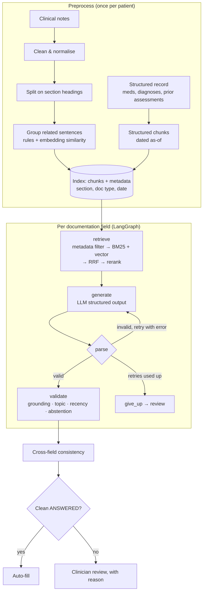

# Clinical Documentation Inference

An LLM pipeline that answers structured clinical documentation questions
("How much help does this patient need to bathe?", "Which medications are
current?") from a patient's record: unstructured clinical notes plus
structured data. Every answer is backed by quoted evidence. When the record
does not support an answer, the pipeline says so instead of guessing. An
evaluation harness measures it against clinician-annotated labels.

> This is a personal re-implementation, on **synthetic data**, of the approach
> I used for clinical documentation inference in a previous role. It contains
> no employer code, data or prompts. Patients, notes and labels are invented.
> Documentation fields are simplified illustrations, not an official
> assessment instrument.

---

## Quick start

```bash
pip install -e ".[dev]"                    # core: pydantic, pyyaml, numpy
pytest                                     # runs offline, < 1 s

python -m clinical_doc.cli run data/patients/p002.json     # one patient -> JSON
python -m clinical_doc.cli evaluate --prompt-version v2    # reports/eval_v2.md
python -m clinical_doc.cli compare                         # v1 vs v2
```

With a real model (LangChain + LangGraph + OpenAI):

```bash
pip install -e ".[llm,dev]"
cp .env.example .env    # set OPENAI_API_KEY
python -m clinical_doc.cli --predictor openai --embedder openai evaluate
```

LangSmith experiment tracking and LLM-judged metrics:

```bash
pip install -e ".[llm,eval]"
python -m clinical_doc.integrations.langsmith_eval --prompt-version v2
python -m clinical_doc.integrations.ragas_eval --prompt-version v2
python -m clinical_doc.integrations.deepeval_eval --prompt-version v2
```

By default the CLI uses `--predictor replay`, which returns recorded model
outputs from `data/fixtures/v1.json` and `v2.json`, so tests and evaluation
are deterministic with no API key. The recorded outputs reflect how each
prompt version behaves, mistakes included. That is what the evaluation below
analyses.

---

## Architecture



| Module | Responsibility |
|---|---|
| `configs/fields.yaml` | Field definitions: question, allowed values, guidance, keywords, metadata filters; cross-field rules |
| `preprocessing.py` | Cleaning, section detection, sentence grouping, chunk metadata, structured-record chunks |
| `retrieval.py` | Metadata filtering, BM25, vector search, Reciprocal Rank Fusion, reranking |
| `embeddings.py` | `OpenAIEmbedder` (LangChain) and an offline `HashingEmbedder` |
| `prompts.py` | Versioned prompts (v1 baseline, v2 after error analysis) |
| `llm.py` | `LangChainPredictor` (ChatOpenAI, structured output) and `ReplayPredictor` |
| `workflow.py` | Node functions + routing for one field; also a dependency-free local runner |
| `graph.py` | The same workflow as a LangGraph `StateGraph` |
| `validation.py` | Deterministic checks that decide auto-fill vs review |
| `evaluation.py` | Field-level metrics, P/R/F1, abstention metrics, error taxonomy, reports |
| `integrations/` | LangSmith experiments, Ragas and DeepEval faithfulness / context recall |

---

## Design decisions

**1. Preprocess into clinically coherent chunks, not fixed-size windows.**
Notes are split on their own section headings first (`FUNCTIONAL STATUS:`,
`DISCHARGE MEDICATIONS:`), the most reliable signal of what a span is about.
Notes without headings are grouped sentence by sentence: a topic change starts
a new group, but a sentence starting with a pronoun or connector stays with the
one before it, and embedding similarity keeps paraphrases together. Splitting
"She walks with a cane" away from the sentence it refers to can change its
meaning. Each chunk carries section type, document type, note id and date.

**2. Structured data is retrieved and dated, not blindly trusted.**
The medication list and prior assessments become chunks with their as-of
date, so a medication list from August competes with a discharge summary from
October on recency rather than overriding it.

**3. Hybrid retrieval with metadata filtering and reranking.**
Each field declares which sections and how far back to look. Inside that
filter, BM25 (question + clinical and lay keywords) and vector similarity are
fused with Reciprocal Rank Fusion, which combines ranks and avoids tuning a
weight between scores on different scales. A reranker then adds recency and
topic overlap. A cross-encoder could replace it behind the same interface.
Only the top chunks reach the model, not the whole record.

**4. Structured output with a strict contract.**
The LLM returns `LLMFieldOutput`: status, answer, evidence
(`chunk_id` + exact quote) and rationale. Pydantic enforces that `ANSWERED` has
an answer and abstentions do not. Invalid output is retried once with the
error fed back. If it is still invalid, the field goes to review.

**5. Two kinds of abstention.**
`INSUFFICIENT_EVIDENCE` means *not supported by the retrieved context*, which
is different from "not in the patient record". `CONFLICTING_EVIDENCE` means
sources from the same period disagree (for example, patient vs caregiver)
and recency does not resolve it. A conflict is clinically useful information,
so it is not silently resolved.

**6. A retrieval miss is never recorded as a clinical fact.**
When the model abstains, the validator sweeps the whole record for the
field's topic:
- topic present in the model's context → `EVIDENCE_IN_CONTEXT_IGNORED` (model problem)
- topic present only outside it → `POSSIBLE_RETRIEVAL_MISS` (retrieval problem)

**7. Deterministic validators decide auto-fill, not model confidence.**
Quotes must exist in the cited chunk, and that chunk must have been in
context. Evidence must mention the field's topic (catches over-inference
such as dressing inferred from bathing). Cited documentation must not be
superseded by newer on-topic documentation (catches temporal errors). Related
fields must be consistent. Only a clean `ANSWERED` result is auto-filled.
Everything else reaches a clinician with the reason attached.

**8. Measure each layer separately.**
Retrieval recall, field-level answer quality and auto-fill safety are reported
independently, and every error is categorised, so the fix can be targeted at
the right component.

---

## Evaluation and iteration

`python -m clinical_doc.cli compare` runs both prompt versions against the
same 15 annotated fields (3 synthetic patients × 5 fields):

| Metric | v1 (baseline) | v2 |
|---|---|---|
| Field-level accuracy | 60% | 87% |
| Retrieval recall | 92% | 92% |
| Abstention F1 | – | 75% |
| Auto-fill precision | 82% | 100% |
| Errors auto-filled (reached chart unreviewed) | 2 | 0 |
| OVER_INFERENCE | 3 | 0 |
| TEMPORAL_CONTEXT | 2 | 0 |
| MISSING_CONTEXT | 1 | 1 |
| INCORRECT_ABSTENTION | 0 | 1 |

**What v1 got wrong.**
- *Over-inference.* With no way to abstain, the model filled every field. It
  scored dressing from a bathing observation, and reported a patient as
  independent with medications although her daughter reported administering
  them.
- *Temporal context.* It scored ambulation from an August note although a PT
  note after the October hospitalization showed contact guard assist, and it
  kept lisinopril on the medication list after the discharge summary
  discontinued it.

**What changed in v2** (`prompts.py`): an explicit abstain option; evidence
must be specific to the field; current status must account for documentation
dates; conflicts are reported. Over-inference and temporal errors went to
zero.

**What v2 did not fix, and why that matters.**
- *Incorrect abstention (p001 medication management).* Making abstention
  explicit made the model slightly over-cautious. The validator catches it
  (`EVIDENCE_IN_CONTEXT_IGNORED`), so it is routed to review instead of
  being lost. Next step: guidance and a few-shot example on what counts as
  sufficient evidence for medication management.
- *Missing context (p003 bathing).* The only bathing information is in a
  social work note's `SOCIAL` section, which the bathing field's metadata
  filter excludes. No prompt change can fix that. The validator flags
  `POSSIBLE_RETRIEVAL_MISS`, and the fix belongs in retrieval: treat section
  filters as a soft prior instead of a hard filter, or add `SOCIAL` for ADL
  fields, then re-measure retrieval recall.

The v1 temporal error on the medication list was **not** caught by any
validator. Only the annotated data revealed it. That is why the evaluation
reports errors that reach the chart unreviewed as a separate metric.

---

## Limitations and next steps

- **Scale of data.** Three synthetic patients exercise every code path but do not
  measure a model. Real numbers need a larger annotated set with inter-annotator
  agreement checked before labels are treated as ground truth.
- **Embeddings.** `HashingEmbedder` is an offline stand-in. Production uses
  `OpenAIEmbedder` (or another embedding model) and a vector store such as pgvector.
- **Temporal reasoning.** Recency is handled with note dates. Notes that describe
  past states inside a new note ("prior to admission she walked independently")
  need sentence-level time tagging during preprocessing.
- **Model choice.** The predictor is behind one interface, so models can be
  compared field by field on the same gold set before weighing cost and latency.
- **Calibration.** With enough labeled data, auto-fill could be enabled per field
  only where measured precision meets the clinical requirement.
